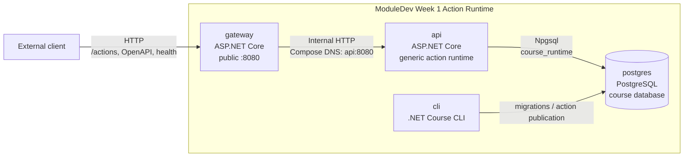

# C4 Container diagram

## Scope

Система публикует зарегистрированные PostgreSQL actions через единый C# gateway и generic C# runtime. Клиент выбирает только опубликованный action и payload. SQL target, policy, trusted context и предметный результат определяются серверной стороной.

## Container diagram

## Responsibilities

| Container  | Responsibility                                                                                                                                                                                                               |
| ---------- | ---------------------------------------------------------------------------------------------------------------------------------------------------------------------------------------------------------------------------- |
| `gateway`  | Единственная внешняя HTTP-точка входа. Публикует порт `8080`, применяет route whitelist и проксирует разрешённые запросы во внутренний `api`. Не содержит action catalog или предметной логики и не обращается к PostgreSQL. |
| `api`      | Проверяет JWT, формирует trusted context, разрешает action из PostgreSQL catalog, валидирует request/result schemas и выполняет `api.invoke(...)` внутри одной Npgsql transaction.                                           |
| `cli`      | Выполняет contract commands: миграции, validation/publication manifest, list, activate и disable.                                                                                                                            |
| `postgres` | Авторитетное состояние системы: action catalog, idempotency, operations, events и autocheck evidence. Выполнение предметного action проходит через зарегистрированные PostgreSQL-функции.                                    |

## Trust and dependency direction

Внешний клиент не имеет прямого доступа к `api` или PostgreSQL.

`gateway` доверяет только внутреннему HTTP API и не интерпретирует предметный payload.

`api` не принимает имя schema, function или SQL от клиента. Target разрешается из immutable action catalog и вызывается через `api.invoke(...)`.

`course_runtime` не имеет прямого DML-доступа к предметным таблицам. Изменения выполняются через доверенные `SECURITY DEFINER` функции, владелец которых имеет `NOLOGIN`.

PostgreSQL хранится в named volume, поэтому пересоздание `gateway` или `api` не уничтожает operation state.
